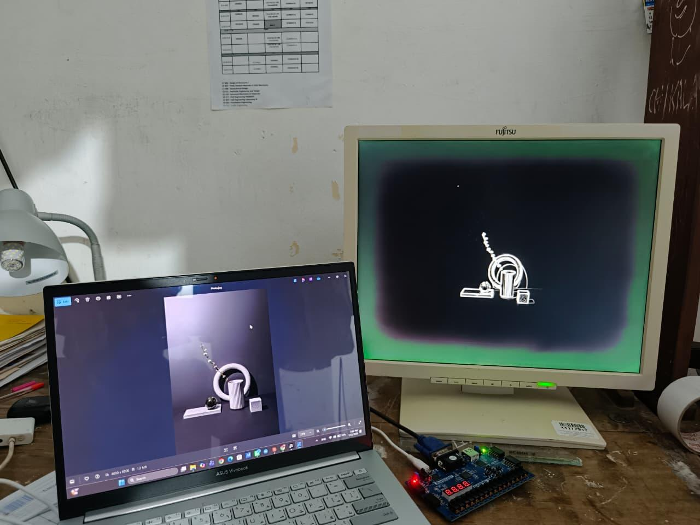
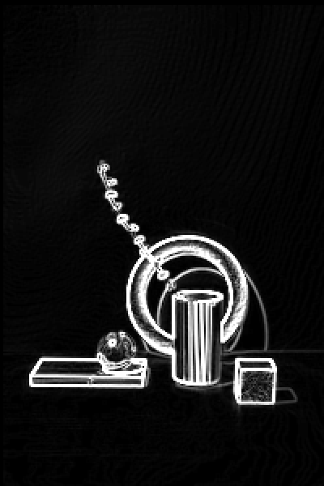
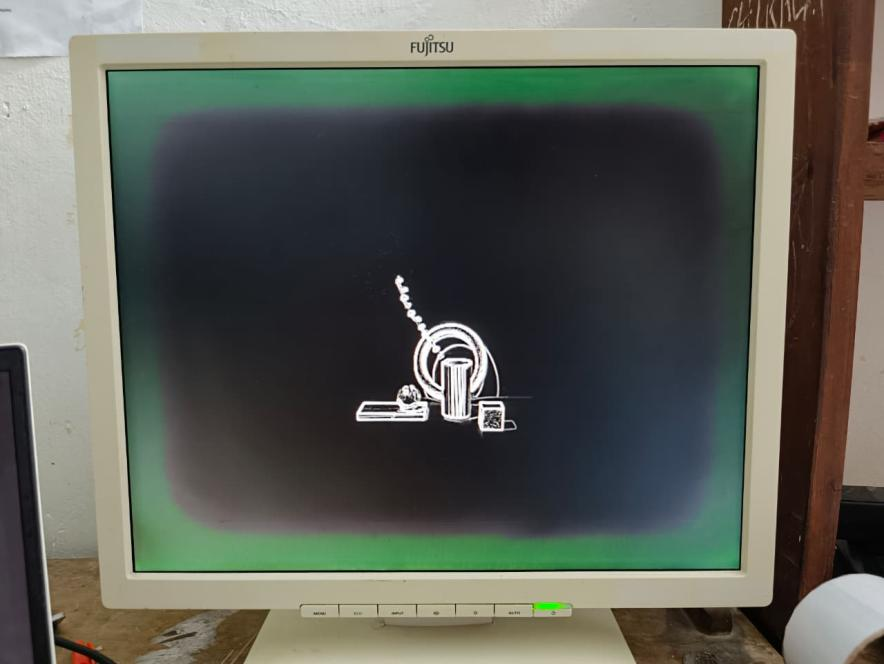
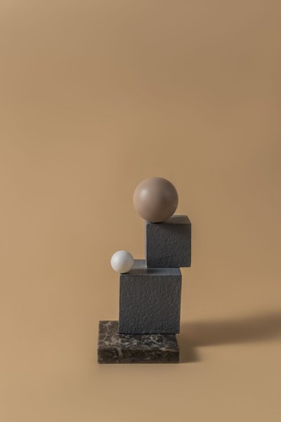
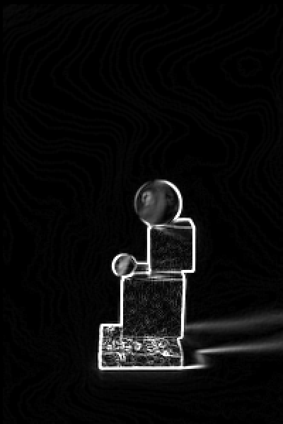
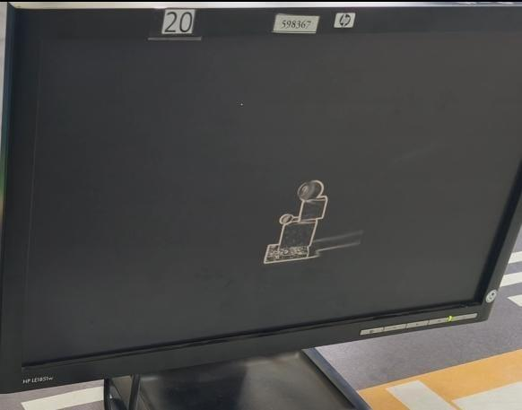

# Real-Time Sobel Edge Detection on FPGA

> A complete hardware image-processing pipeline in Verilog, taken from RTL to a live edge-detected image on a VGA monitor, running on a Digilent Basys3 (Artix-7) board.



**Course:** EE587 – Milestone 2, Semester 6, University of Peradeniya · **Duration:** May 2026 – Aug 2026

**Board:** Digilent Basys3 (Xilinx Artix-7 XC7A35T) · **Language:** Verilog · **Tools:** Vivado, Python (NumPy, Pillow)

**Individual project**

---

## Results

| Input photo | RTL simulation output | Running on the FPGA (VGA) |
|---|---|---|
|  |  |  |
|  |  |  |

- **Bit-exact verification:** a NumPy reference model ([`scripts/sobel_model.py`](scripts/sobel_model.py)) reproduces the RTL simulation output exactly, **60,000 of 60,000 pixels** (200×300 image).
- **Verified on hardware:** the board displays the edge map live over VGA at 640×480 @ 60 Hz.
- <sub>The green tint in the first VGA photo is a fault in that lab monitor, not the design.</sub>

## Architecture

```
                ┌──────────────┐  1 pixel/clk   ┌───────────────────────────┐
 image.mem ───> │  image_rom   ├──────────────> │        sobel_core         │
 ($readmemh)    │  (BRAM)      │ raster stream  │ 3 row buffers + tap regs  │
                └──────────────┘                │ Gx, Gy → |Gx|+|Gy| → sat8 │
                       ▲                        └─────────────┬─────────────┘
                addr_cnt (runs once                           │ waddr = row·W + col
                after reset, 100 MHz)                         ▼
                                                ┌───────────────────────────┐
  VGA monitor <── vga_timing <── pixel_clk_en   │  output_bram (frame buf)  │
  640×480@60Hz     (hsync,        (1-in-4       └─────────────┬─────────────┘
       ▲            vsync,         strobe)                    │ raddr (centred window)
       └──────────── R,G,B = top 4 bits of edge magnitude ────┘
```

| Module | Role |
|---|---|
| [`top_sobel_vga.v`](rtl/top_sobel_vga.v) | Top level: compute-once control (`addr_cnt`, `feeding`, `compute_done`), centring, VGA colour out |
| [`sobel_core.v`](rtl/sobel_core.v) | Row buffers, 3×3 window, signed Gx/Gy, Manhattan magnitude, 8-bit saturation |
| [`image_rom.v`](rtl/image_rom.v) | Source image in BRAM, loaded with `$readmemh` |
| [`output_bram.v`](rtl/output_bram.v) | Frame buffer holding the computed edge map |
| [`vga_timing.v`](rtl/vga_timing.v) | 640×480 @ 60 Hz counters, hsync/vsync/video_on |
| [`pixel_clk_en.v`](rtl/pixel_clk_en.v) | 1-in-4 enable strobe, a 25 MHz pixel rate inside the 100 MHz domain |

### Key design decisions

**1. Compute once, display continuously.** After reset, every source pixel is streamed through the Sobel core once, at the full 100 MHz, and the result is written to a frame buffer. The VGA side then just scans out that buffer. This decouples the processing pipeline from the video refresh rate, at the cost of a second full-frame BRAM.

**2. Streaming 3×3 window.** Three row buffers (`r1`, `r2`, `r3`) shift down one row as each pixel arrives. Two delay taps per row (`_t1`, `_t2`) supply the previous two columns, so a complete 3×3 neighbourhood is available every clock without re-reading memory.

**3. Signed fixed-point gradients.** Gx and Gy use the standard Sobel kernels in signed arithmetic, so negative partial sums are handled correctly. The magnitude is |Gx| + |Gy| (the Manhattan approximation, which avoids a square root), saturated to 255.

**4. One clock domain.** VGA timing advances on a 1-in-4 enable pulse rather than a divided 25 MHz clock. With only one clock in the design, there are no clock-domain-crossing hazards and no extra clock buffers.

**5. Native-resolution centring.** The 200×300 image is shown at native resolution in the centre of the 640×480 frame. R, G and B all carry the top 4 bits of the magnitude, giving a grayscale edge map.

## Verification

```
 photo.jpg ─> image_to_mem.py ─> image.mem ─┬─> tb_top_sim (Vivado XSim) ─> output_full.mem ─┐
                                            │                                                ├─> sobel_model.py --compare
                                            └─> sobel_model.py (NumPy) ───> model_out.mem ───┘     PASS: 60000/60000
                                                         mem_to_image.py ─> result.png (visual check)
```

- **`tb_top_sim.v`** runs only the compute path (ROM → Sobel → frame buffer), waits for `compute_done`, and dumps the frame buffer with `$writememh`.
- **`sobel_model.py`** is a NumPy model that mirrors the hardware's exact window alignment, arithmetic and saturation, then compares itself with the RTL dump pixel by pixel.
- **`image_to_mem.py` / `mem_to_image.py`** convert real photographs into BRAM init files and back, so the design can be tested on real images, not just synthetic patterns.

Reproduce the check with the included files:
```bash
python scripts/sobel_model.py images/blocks_image.mem 200 300 model_out.mem --compare images/blocks_rtl_output.mem
# PASS: RTL output matches the model bit-for-bit (60000 pixels)
```

## Implementation results (Vivado, post-route, XC7A35T)

| Resource | Used | Available | Utilization |
|---|---|---|---|
| Slice LUTs | 474 | 20,800 | 2.3 % |
| ↳ LUT as distributed RAM (row buffers) | 96 | 9,600 | 1.0 % |
| Flip-flops | 162 | 41,600 | 0.4 % |
| Block RAM (36 Kb tiles) | 24 | 50 | 48 % |
| On-chip power | 0.115 W | | |

The logic footprint is very small. BRAM is the main cost, because both the source image and the frame buffer are stored on chip.

## Challenges & what I learned

- **Row-mixing in the line buffer (read-after-write hazard).** The first version produced edges with pixels from different rows mixed together, because a row buffer was being updated and read for the window at the same column in the same cycle. **Fix:** all three buffers are read combinationally (`r1_now`, `r2_now`, `r3_now`) *before* the non-blocking shift (`r3[col] <= r2[col]; r2[col] <= r1[col]; r1[col] <= pixel_in`). That way the window always sees the previous rows' values.
- **Timing closure (known issue).** The routed design shows **WNS = −3.5 ns** at 100 MHz. The critical path runs from the column counter, through the row-buffer read, Gx/Gy, absolute value, sum and saturation, to `pixel_out`: **23 logic levels in one cycle (~13.5 ns)**. The demo worked on the board, but the design is not timing-clean. **Planned fix:** split `sobel_core` into 2–3 pipeline stages (window register → Gx/Gy → magnitude and saturation) and delay `row_out`, `col_out` and `valid_out` to match.
- **Decoupling compute from display.** Streaming Sobel output straight to VGA would tie the pipeline to the pixel clock and the blanking intervals. The frame buffer removed that constraint entirely.

## Known limitations
- The window covers rows `row-3…row-1` and columns `col-2…col`, so the edge map is offset by 2 rows and 1 column, and the first 3 rows and 2 columns are black. The reference model reproduces this exactly.
- Only one static image is processed per bitstream. A live source would need a re-trigger and double buffering.
- Displays 4 bits per channel (the Basys3's VGA DAC), so the 8-bit magnitude is truncated.

## Repository structure
```
├── rtl/          # synthesizable Verilog (6 modules)
├── sim/          # tb_top_sim.v — compute-path testbench
├── constraints/  # basys3_vga.xdc — clock, reset, VGA pins
├── scripts/      # image_to_mem.py, mem_to_image.py, sobel_model.py
├── images/       # test images (.mem) and RTL output dump
├── media/        # photos and result images
└── docs/         # report.pdf
```

## How to run
1. **Prepare an image** (resized to fit 200×300 by default):
   `python scripts/image_to_mem.py photo.jpg image.mem`
   It prints the final width and height. Set `IMG_WIDTH` and `IMG_HEIGHT` in `top_sobel_vga.v` and `tb_top_sim.v` to match.
2. **Simulate** in Vivado: add `rtl/` and `sim/`, add `image.mem` as a simulation source, and run `tb_top_sim`. It writes `output_full.mem`.
3. **Check:** `python scripts/sobel_model.py image.mem 200 300 model_out.mem --compare output_full.mem`, and optionally `python scripts/mem_to_image.py output_full.mem 200 300 result.png`.
4. **Build:** create a project for `xc7a35tcpg236-1`, add `rtl/`, `constraints/` and `image.mem` as a design source, then generate the bitstream.
5. **Run:** program the Basys3, connect a VGA monitor, and press **btnC** to reset and recompute.

## Future work
- Pipeline `sobel_core` to close timing at 100 MHz.
- Live camera input (e.g. OV7670) with double-buffered frames.
- A threshold and mode selection (original / edges) on the slide switches.
- Other 3×3 kernels (Gaussian blur, sharpen) on the same window hardware.
